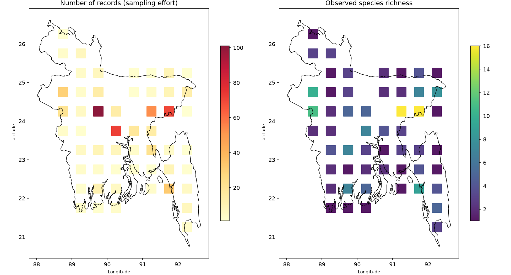
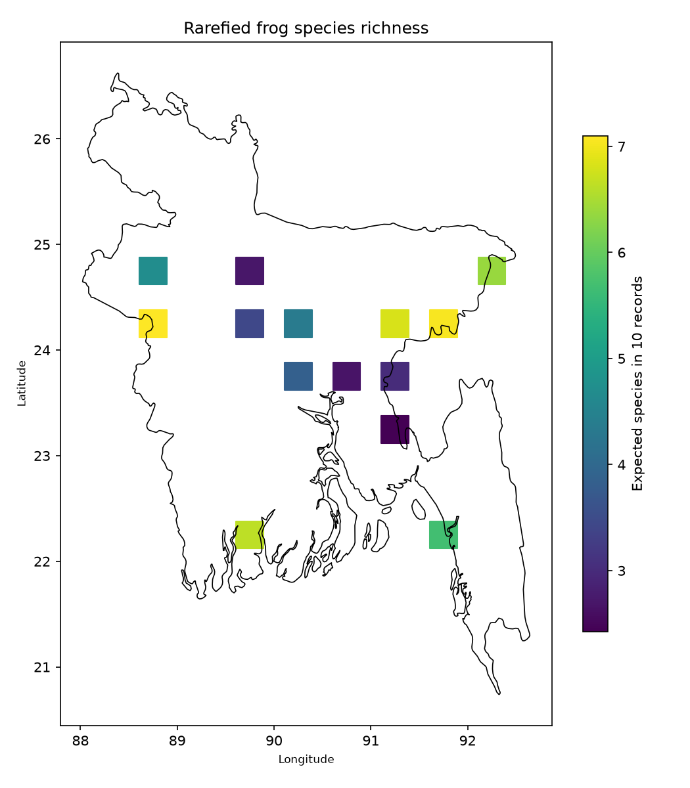
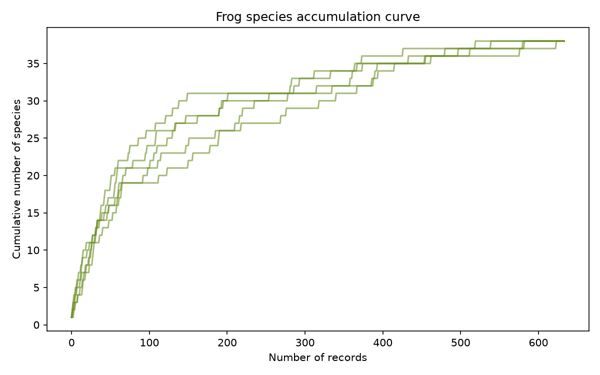

# Bangladesh Frog Records: Sampling Bias in GBIF Data

## Question

Does a map of frog records in Bangladesh show where frogs live,
or where observers go?

## Data

- Frog and toad (order Anura) occurrence records for Bangladesh from
  GBIF (country = BD, records with coordinates, accessed via pygbif)
- 1079 raw records, 49 species
- 813 of the 1079 raw records (75%) come from iNaturalist
- 634 records and 38 species after cleaning
- Country border from Natural Earth

## Methods

1. Downloaded all records with coordinates through the GBIF API
2. Cleaned the data:
   - removed records without a species name (104)
   - removed locations with more than 10 km uncertainty (156)
   - kept sightings only (HUMAN_OBSERVATION), removing specimens,
     material samples and literature citations (185)
3. Compared grid sizes of 0.25, 0.5 and 1.0 degrees and chose 0.5
   degrees, because it kept the same number of usable cells as 0.25
   degrees without splitting records too thinly
4. Rarefied richness to 10 records per cell (14 usable cells)
5. Sensitivity check: 3 cell sizes x 3 sample sizes (5, 10, 15)
6. Repeated the analysis including specimens and other
   non-sighting records
7. Built a species accumulation curve

## Results

- **Time bias:** 2026 alone has 241 of 634 records (38%), and
  2025 and 2026 together have 54%. Before 2014, there are
  fewer than 5 records per year.
- **Space bias:** 27 of 53 grid cells (0.5 degrees) have fewer than
  5 records, so most of the country is poorly known.
- **Effort is not richness:** the cell with the most records (101,
  north of Dhaka) has only 5 species, while cells with 53 and 70
  records have 16 species each.
- **Rarefaction reduced the effort effect:** the rank correlation
  between richness and number of records fell from 0.36 (observed)
  to 0.06 (rarefied) at 0.5 degrees and 10 records. Across all 9
  settings the rarefied correlation was lower than the observed one,
  and between -0.10 and 0.15 in 7 of 9. The two exceptions were
  0.25 degrees / 10 records (0.50) and 1.0 degrees / 5 records
  (-0.39).
- **Richest areas:** three cells have the highest rarefied richness
  (6.8 to 7.1 expected species in 10 records): one in the west
  (88.5E, 24.0N) and two in the northeast (91.0E and 91.5E, 24.0N).
  The differences between them are too small to rank.
- **Specimens:** including specimens and other non-sighting records
  adds 8 species (38 to 46) and 6 usable cells (14 to 20), but the
  same three cells stay on top (rarefied richness 6.8 to 7.2).
- **Species accumulation curve:** [write here whether the curve
  flattens or keeps rising, and what that means]

## Summary in my own words

Frog records in Bangladesh are very unevenly sampled. Three quarters come from iNaturalist and over half were recorded in 2025 and 2026, and 27 of 53 grid cells have fewer than 5 records. The most-sampled cell had only 5 species, so many records did not mean many species. After rarefaction, effort no longer predicted richness in most settings, and the west and northeast had the highest values, but the differences were too small to rank them. With only 14 usable cells, my results are suggestive, not proven.

## Limitations

- Only 14 usable cells, so the results are descriptive, not
  statistical. Correlations are suggestive, not proof.
- Three quarters of the data come from one platform (iNaturalist),
  and records are strongly concentrated in 2025 and 2026.
- 11 of the 49 raw species are absent from the cleaned data: 8 are
  known only from specimens or other non-sighting records, and 3 were
  lost by removing imprecise locations.
- 240 records with no location uncertainty value were kept, because
  their accuracy could not be checked.
- The top cell changes with grid size (a possible example of the
  modifiable areal unit problem; I did not test the cause).
- No correction for observer skill, detectability, or season.
- Absence of records in an area does not mean absence of frogs.

## Reproduce

    python3 -m venv venv && source venv/bin/activate
    pip install -r requirements.txt
    python scripts/01_download_frogs.py
    python scripts/03_clean_frogs.py
    python scripts/05_map_frogs.py
    python scripts/06_rarefaction_frogs.py
    python scripts/07_sensitivity_frogs.py
    python scripts/09_compare_specimens.py

Scripts 00, 02, 04 and 08 are exploration steps (checking the taxon
key, inspecting the raw data, choosing the grid, counting
specimen-only species). The `data/` folder is not stored in Git,
so run the download script first. GBIF is updated continuously, so
new downloads may give slightly different numbers.

## Author

Nazim Uddin, BSc Zoology, University of Chittagong
